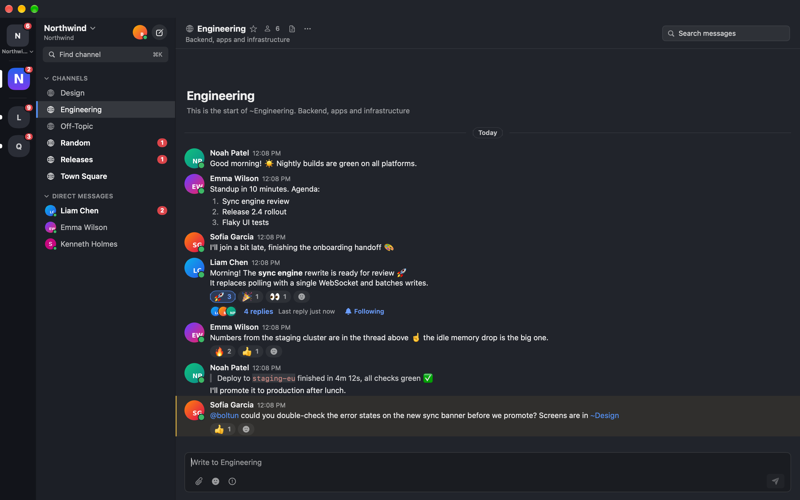
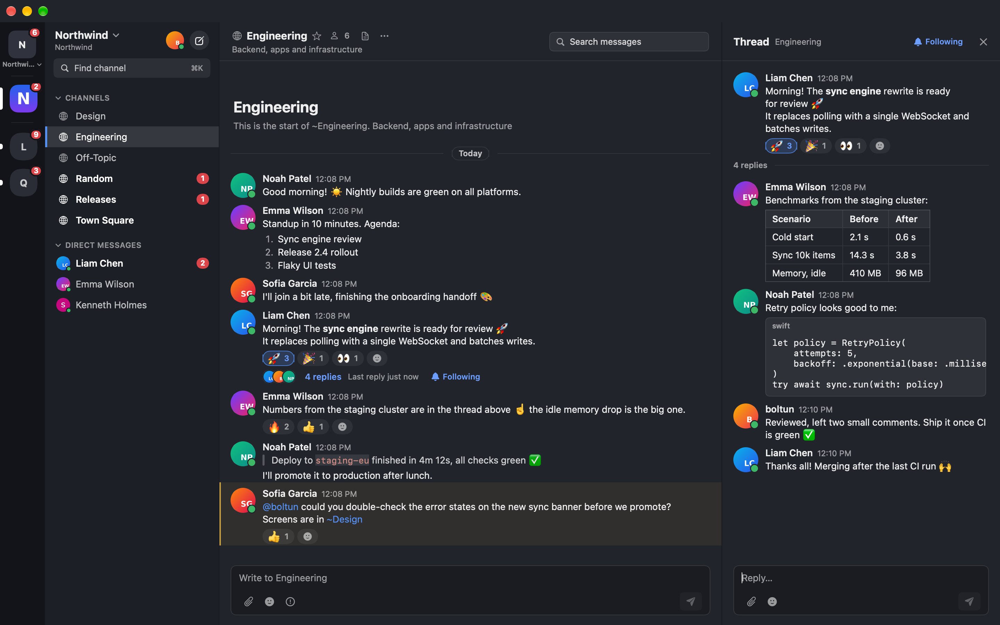
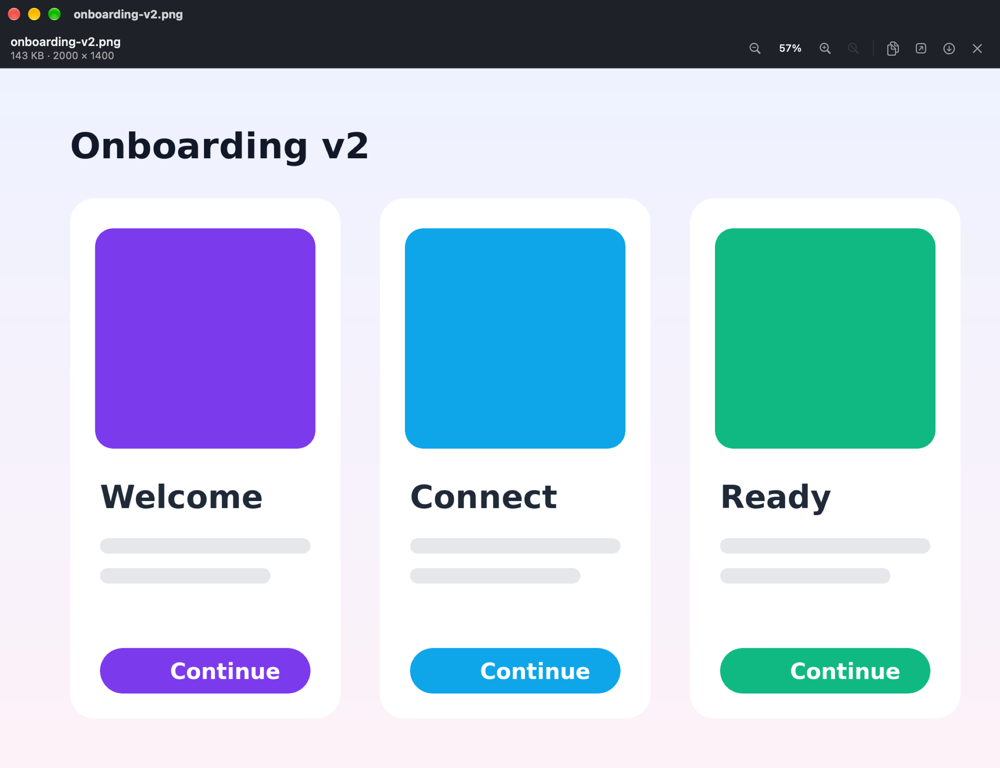
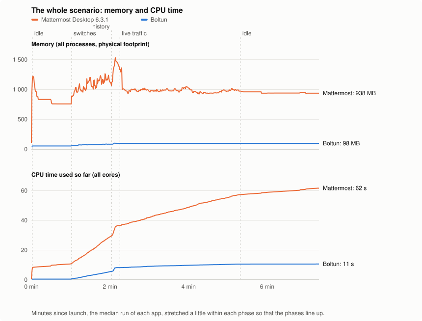

# Boltun

A fast, native macOS client for [Mattermost](https://mattermost.com), built with Swift, SwiftUI and AppKit.
It is a lightweight replacement for the Electron-based [Mattermost Desktop](https://github.com/mattermost/desktop):
no bundled browser, no web view, just the Mattermost REST API and WebSocket.



| Threads in the right pane | Full-resolution image viewer |
|:--:|:--:|
|  |  |

## Benchmark: Boltun vs Mattermost Desktop

Both apps sign in to the same three servers and go through the same scripted steps: launch, idle, 35 channel, team
and server switches, scrolling back through 1000 posts, 3 minutes of live traffic on all servers, idle. Measured on
macOS 27 (Apple M4 Pro VM, 8 GB), medians of three runs. The scripts are in [`scripts/bench`](scripts/bench/run.sh).
The full table, the method and what is still slower in Boltun (team switches, and going back to a server) are in
[docs/benchmark.md](docs/benchmark.md).

| | Mattermost Desktop 6.3.1 | Boltun |
|:--|--:|--:|
| Launch until the first channel shows its posts | 1.9 s | 0.55 s |
| Launch until all three servers are connected | 2.1 s | 0.35 s |
| Switch channel, team or server (median) | 113 ms | 99 ms |
| Scroll a 1000-post channel back to its start | 4.7 s | 3.0 s |
| Memory, idle after launch | 764 MB (12 processes) | 54 MB (1 process) |
| Memory after 3 min of live traffic | 974 MB | 95 MB |
| CPU time for 3 min of live traffic (all cores) | 20.6 s | 2.2 s |
| CPU when idle | 3.7 % of a core | 0.0 % of a core |
| App size on disk | 292 MB | 14 MB |



## Features

- Multiple servers side by side, each with its own session and unread/mention badges
- Teams in a vertical team sidebar with icons and unread badges (⌃⌘1…9 jumps to a team, ⌃⌘↑/↓ cycles teams); drag teams to reorder them and pin favorites above a divider
- Sidebar categories (favorites, channels, direct messages), unread and mention counters
- Real-time messages, edits, deletions, reactions and typing indicators over WebSocket
- Markdown rendering, emoji, @mentions, code blocks, links, file attachments and image previews
- Collapsed reply threads (on by default): replies open in the thread pane with participants, reply count and last reply time; turn it off in Settings to show replies inline
- Thread following: follow or unfollow a thread from its footer, the thread pane or the message menu; threads where you are mentioned, `@all`/`@channel` is used or one of your notification keywords appears are followed automatically, as the server's notification settings decide
- Presence: online, away and do-not-disturb dots on message avatars, direct messages and search results, and your own status picker in the sidebar header
- Message priority: send standard, important or urgent messages with an optional acknowledgement request and persistent notifications; priority labels appear next to the author
- Acknowledgements: acknowledge a message that asked for it, see the count and who acknowledged it and when, updated live
- Burn-on-read messages: recipients reveal a concealed message and watch its countdown, the sender sees how many recipients read it, and expired messages disappear by themselves
- Read status in direct and group messages: one checkmark once your message is sent, two blue checkmarks once it has been seen, and two grey checkmarks while only some group members have seen it (hover for who); turn it off in Settings
- Search, quick channel switcher
- Native notifications and a dock badge
- Notification control: mute a channel or conversation from the sidebar or channel menu, and per-channel notification preferences (desktop level, thread replies, ignoring `@channel`/`@here`/`@all`); muted teams can be silenced locally from the team sidebar
- Dark theme

Priority, acknowledgements and burn-on-read follow the server: their controls stay hidden where the configuration or the
license does not offer them. Audio and video calls are not supported.

## Install

Download the latest `Boltun-*-macos-arm64.zip` from [Releases](https://github.com/malkafen/boltun/releases),
unzip it and move `Boltun.app` to `/Applications`. The app is ad-hoc signed, so on first launch right-click it and
choose **Open**, or run:

```bash
xattr -dr com.apple.quarantine /Applications/Boltun.app
```

Requires macOS 15 or later on Apple Silicon.

## Build from source

```bash
scripts/test.sh          # run the tests
scripts/coverage.sh      # tests with a coverage report
scripts/build-app.sh     # build/Boltun.app
```

See [AGENTS.md](AGENTS.md) for the project layout and conventions.

## License

Apache License 2.0, see [LICENSE](LICENSE).
