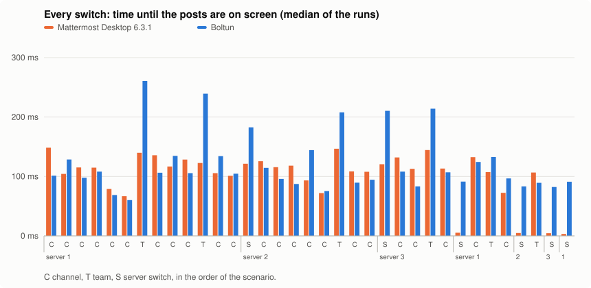

# Benchmark: Boltun vs Mattermost Desktop

Both apps get the same three servers, the same account and the same scripted steps. The scripts are in
[`scripts/bench`](../scripts/bench), and the raw results of every run are in [`benchmark/`](benchmark).

## Setup

- macOS 27.0.1 in a VM on an Apple M4 Pro host, 8 cores, 8 GB of memory. Both windows are 1240 × 820 points.
- Mattermost Desktop 6.3.1, the official Electron app (`mattermost-desktop-6.3.1-mac-arm64.zip`). It runs from the work
  directory, not from `/Applications`, with auto-update off and a data directory of its own (`--dataDir`).
- Boltun 0.7.0, built with `scripts/build-app.sh`. It runs as a copy with its own bundle id
  (`io.github.malkafen.boltun.bench`) and its own home directory (`CFFIXED_USER_HOME`), with debug automation on.
- Three Mattermost 12.0.1 servers in Docker on a Linux host on the same network: two Team Edition servers with 3 and 2
  teams, and an Enterprise Edition server with the Entry license and 2 teams. Both apps sign in to all three as the
  same user.
- [`prepare.py`](../scripts/bench/prepare.py) creates the channel `bench-history` with 1000 posts by two authors. It
  also gives every channel and direct message that the scenario visits at least 30 posts. The text is seeded, so it is
  the same every time.
- Each app signs in to the three servers once, through its own UI: real clicks in Mattermost Desktop, debug commands in
  Boltun. It then visits every team and quits. Every run starts from a copy of this logged-in profile, and from the
  same unread state on the servers.
- Before the measured runs, each app is launched once. The runs then alternate (Boltun, Mattermost, Mattermost,
  Boltun, Boltun, Mattermost), three per app, and never overlap. The tables show the medians.

## Scenario

1. **Launch** into Town Square of the first team on the first server.
2. **Idle** for 60 s.
3. **35 switches**: 23 channel switches (including two direct messages), 6 team switches and 6 server switches,
   1.5 s apart, across all three servers. They are listed in [`scenario.py`](../scripts/bench/scenario.py).
4. **History**: open `bench-history` (1000 posts) and scroll back to its first post. A scroll goes up to the top, and
   another follows as soon as older posts arrive, or after 0.25 s if none do.
5. **Live traffic** for 3 minutes ([`traffic.py`](../scripts/bench/traffic.py)): 60 posts on each server at once,
   one every 3 s, posted by another user. The mix is mentions, direct messages, Markdown (code, tables, lists,
   quotes) and thread replies. A quarter of the first server's posts go to the open channel. The plan is seeded, so
   every run gets the same posts.
6. **Idle** for 2 minutes.

## What is measured

- **Time**: from the action until the first frame that shows the posts.
  - **Mattermost Desktop** is driven through the Chrome DevTools Protocol with real mouse clicks and wheel events
    ([`mmbench.py`](../scripts/bench/mmbench.py)). The clock starts at the page's own `mousedown` or `wheel` event.
    It stops at the first animation frame in which the expected channel's posts are on screen and the server's view
    is visible.
  - **Boltun** is driven through its debug automation ([`bbench.py`](../scripts/bench/bbench.py),
    [`automation.md`](automation.md)). The clock starts when the app receives the command. It stops when the
    channel's rows are on screen, stamped after Core Animation has committed the frame
    ([`AutomationProbe.swift`](../Sources/BoltunUI/App/AutomationProbe.swift)).
  - Launch counts from the `open` command. "Connected" is when the last of the three WebSockets connected.
- **Longest freeze**: the longest time the app could not respond in the same window.
  - **Mattermost Desktop**: the longest gap between painted frames of its server views. During live traffic it is the
    longest long task of the visible view, because recording frames there would add load. Long tasks are only
    reported from 50 ms.
  - **Boltun**: the longest pass of the main run loop.
- **CPU time and memory**: [`sample.py`](../scripts/bench/sample.py) reads the kernel's accounting of every process of
  the app four times a second.
  - CPU time is user + system on all cores.
  - Memory is the physical footprint, which Activity Monitor shows as Memory.
  - Mattermost Desktop runs 12 processes and Boltun 1. The sums cover all of them.

## Results

| | Mattermost Desktop 6.3.1 | Boltun |
|:--|--:|--:|
| Launch until the first channel shows its posts | 1.9 s | 546 ms |
| Launch until all three servers are connected | 2.1 s | 353 ms |
| Switch channel, team or server (median of 35) | 113 ms | 99 ms |
| — channel switches only (median of 23) | 113 ms | 98 ms |
| — team switches only (median of 6) | 131 ms | 218 ms |
| — server switches only (median of 6) | 5 ms | 91 ms |
| — slowest switch | 150 ms | 284 ms |
| — longest freeze while switching | 88 ms | 86 ms |
| Open a channel with 1000 posts | 115 ms | 96 ms |
| Scroll it back to its first post | 4.7 s | 3.0 s |
| Longest freeze during 3 min of live traffic | 56 ms | 28 ms |
| Memory, idle 60 s after launch | 764 MB | 54 MB |
| Memory after 35 switches | 1 051 MB | 84 MB |
| Memory after scrolling back 1000 posts | 1 444 MB | 99 MB |
| Memory after 3 min of live traffic | 974 MB | 95 MB |
| Memory after 2 min idle at the end | 936 MB | 95 MB |
| Processes / threads, idle after launch | 12 / 218 | 1 / 7 |
| App size on disk | 292 MB | 14 MB |

| CPU time (all cores) / peak memory | Mattermost Desktop 6.3.1 | Boltun |
|:--|--:|--:|
| Launch until ready | 5.9 s / 1 052 MB | 386 ms / 42 MB |
| Idle 60 s after launch | 5.7 % of a core | 0.3 % of a core |
| 35 switches | 18.0 s / 1 280 MB | 5.0 s / 86 MB |
| Open and scroll back 1000 posts | 6.3 s / 1 533 MB | 2.5 s / 101 MB |
| 3 min of live traffic | 20.6 s / 1 363 MB | 2.2 s / 98 MB |
| — average load during the traffic | 11.2 % of a core | 1.2 % of a core |
| Idle 2 min at the end | 3.7 % of a core | 0.0 % of a core |
| **Whole scenario** | 59.2 s / 1 533 MB | 10.5 s / 101 MB |
| — wall time | 440 s | 438 s |
| — average memory | 970 MB | 87 MB |

The runs agree closely:
- Launch took 1.8–2.0 s in Mattermost Desktop and 0.53–0.57 s in Boltun.
- The median switch took 109–118 ms against 98–105 ms.
- Scrolling back took 4.7 s in all three Mattermost Desktop runs, and 2.5–3.6 s in Boltun. Boltun varies more because
  some of its scrolls to the top load nothing and wait for the next one.

Each CPU row covers its step from start to end, waits included. Peak memory is the highest sample in that span.




## What is slower in Boltun

- **Going back to a server.** Mattermost Desktop keeps every server's webapp alive in a view of its own, so showing a
  server again takes one frame: 5 ms. Boltun builds the main view again for the selected server, which takes 80–95 ms
  on a return and 180–210 ms the first time. Neither freezes for longer than in a channel switch. Mattermost Desktop
  pays for its views in memory: three live webapps.
- **Team switches.** The median is 218 ms against 131 ms, and the slowest switch of the whole scenario (284 ms) is one
  of them. Boltun loads a team's channels, memberships and categories the first time the team is opened, and shows it
  only after that. Later visits take 90–135 ms.
- **Where a team switch lands.** Mattermost Desktop goes back to the channel you last read in that team. Boltun opens
  Town Square: it remembers the last channel per team only across restarts. The scenario leaves every team on Town
  Square before it switches back to it, so that both apps open the same channel.

Channel switches, opening a long channel, and freezes while switching are on par: within 20 ms of each other, with
Boltun slightly ahead. Everything else in the tables favors Boltun:
- launch is 3–6 times faster;
- memory is 10–15 times lower;
- CPU time is almost 6 times lower over the whole scenario and 9 times lower during live traffic;
- CPU stays at about zero while idle.

## Caveats

- **Different drivers.** Mattermost Desktop gets real input events, while Boltun's debug commands call the same code
  as a click but skip hit-testing and event dispatch. Both clocks start inside the app, at the input event or the
  command, so neither counts the driver's own latency. The Mattermost driver runs a small script in each server page
  (it records frames during switches and polls during launch), which adds a little CPU time to Mattermost Desktop.
- **Different freeze measures.** A painted-frame gap in Mattermost is not exactly a run loop pass in Boltun. Both
  measure how long the window could not respond, but at 60 Hz the frame gap cannot be lower than about 17 ms.
- **History scrolling.** Mattermost Desktop scrolls with the mouse wheel, Boltun with its scroll-to-top command. When
  that jump lands while Boltun is still adjusting the scroll position after a page of older posts, nothing loads until
  the next scroll; that is where Boltun's spread comes from. Mattermost Desktop loads about 30 posts per page
  (33 scrolls), Boltun 60 (16–18 scrolls).
- **Server setup changed during the runs.**
  - The apps reach the servers under host names of their own (`bench-8065.test` and so on, added to `/etc/hosts`).
    Browsers keep cookies per host, not per port, so Mattermost Desktop cannot stay logged in to three servers on one
    address.
  - These names are added to each server's `AllowCorsFrom`, so that the webapp's WebSocket is accepted.
  - Link previews are off: the test servers cannot reach the internet, so the first load of posts with links waited
    5–10 s for a preview to time out, in whichever app came first.
  - `run.sh` undoes all three changes at the end.
- **Warm start.** Both profiles were logged in and had visited every team before, so caches are warm. Notification
  permission was never answered in either app, so no banners were shown.
- **One machine, a VM.** Absolute numbers on other hardware will differ. Ratios should hold roughly.
- **Not measured.** Energy use, GPU memory, network traffic, and the look of the rendered messages.

## Run it yourself

On a Mac with network access to the test servers (see `AGENTS.md`) and passwordless `sudo` for `/etc/hosts`:

```bash
scripts/bench/run.sh      # RUNS=3 by default, about an hour; work files go to /tmp/boltun-bench (BENCH_DIR)
BENCH_QUICK=1 RUNS=1 scripts/bench/run.sh   # a 5-minute rehearsal with short idle and traffic phases
```

`run.sh` downloads Mattermost Desktop into the work directory, builds Boltun, prepares the data and profiles, runs the
scenario, and writes the raw results, the charts (`chart.py`) and the tables (`report.py`). It quits running copies
of both apps first. Your own Mattermost Desktop and Boltun profiles are not touched, but Mattermost Desktop writes its
log to `~/Library/Logs/Mattermost`.
